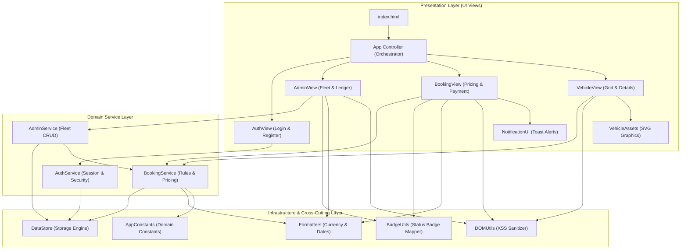

# GoCar Car Rental Booking System — Refactoring Report

**Course:** CSEB5213 Software Evolution & Maintenance  
**System:** GoCar Malaysia Academic Prototype  
**Baseline Directory:** `codebase-a-simple-prompt/`  
**Refactored Directory:** `refactored-codebase/`  
**Document Status:** Complete Implementation & Verification Report  

---

## 1. Refactoring Objectives

The primary objective of this refactoring initiative was to transition the GoCar Car Rental Booking System from a tightly coupled, monolithic script architecture into a clean, modular, and maintainable design while preserving 100% of existing user workflows, features, and SRS acceptance criteria.

Specific targets included:
1. **Deconstruct the Monolithic Controller (`App`):** Dismantle the 1,284-line God Object into high-cohesion, low-coupling modules aligned with the Single Responsibility Principle (SRP).
2. **Encapsulate Scattered Business Rules:** Consolidate duplicated "Active Booking" availability criteria into a single domain predicate (`BookingService.isActiveBooking`).
3. **Eliminate Security Vulnerabilities:** Mitigate stored and DOM-based Cross-Site Scripting (XSS) risks by sanitizing all dynamic data injected into the DOM via `DOMUtils.escapeHTML()`.
4. **Eliminate Magic Strings and Numbers:** Standardize domain statuses, roles, persistence keys, and mathematical conversion factors into an immutable constants module (`app-constants.js`).
5. **Decouple Vector Assets from Logic:** Extract 80+ lines of raw SVG markup and styling coordinates from the application controller into a dedicated presentation component (`VehicleAssets`).
6. **Standardize Formatting:** Unify ad-hoc currency and date manipulations under a single utility module (`Formatters`).
7. **Eliminate Duplicate Presentation Logic:** Extract identical status-to-CSS badge mappings from customer booking history and administrator booking management into a centralized, reusable utility (`BadgeUtils`).
8. **Maintain Zero-Build Compatibility:** Ensure the refactored project remains completely native (HTML5/CSS3/Vanilla ES6 JavaScript) and runs instantly upon opening `index.html` in any browser or local static server without external frameworks or build tooling.

---

## 2. Refactoring Strategy & Architectural Transformation

### 2.1 Architectural Redesign



### 2.2 Techniques Applied

| Refactoring Technique | Motivation & Problem Addressed | Concrete Implementation |
|---|---|---|
| **Extract Module / Class** | Monolithic `App` controller (CS-01) contained 1,284 lines managing routing, DOM events, SVG rendering, and modal workflows. | Created 6 dedicated UI modules: `VehicleView`, `BookingView`, `AdminView`, `AuthView`, `NotificationUI`, and `VehicleAssets`. |
| **Extract Utility** | Repetitive inline currency conversions and XSS vulnerabilities (CS-03, CS-06). | Created `Formatters` (for currency, date, and durations) and `DOMUtils` (for HTML entity escaping and DOM updates). |
| **Extract Utility (BadgeUtils)** | Status-to-CSS badge class mapping duplicated between customer history and admin bookings views (Section 4.1.3 / CS-02). | Extracted `BadgeUtils` (`badge-utils.js`) providing `getBookingBadgeClass(status)` and `getPaymentBadgeClass(status)`. |
| **Replace Magic Strings with Named Constants** | Domain statuses (`'Confirmed'`, `'Pending Payment'`) hardcoded across multiple files (CS-04). | Extracted `BOOKING_STATUS`, `PAYMENT_STATUS`, `USER_ROLES`, `STORAGE_KEYS`, and `TIME_CONSTANTS` into `app-constants.js`. |
| **Replace Duplicated Code with Shared Function** | Active booking definition duplicated across 4 distinct files (CS-02). | Centralized into `BookingService.isActiveBooking(booking)`. |
| **Separate UI from Business Logic** | Presentation views directly embedded calculations and unescaped HTML templates. | Separated business calculations into service methods and views into declarative renderers. |
| **Event Delegation** | Inline `onclick` handlers in HTML strings created tight coupling to global window objects (CS-07). | Replaced with container-level event delegation using `data-action` and `data-id` attributes. |

---

## 3. Detailed File Inventory (Refactored Codebase)

The refactored project is organized under `refactored-codebase/` with clear directory separation:

```text
refactored-codebase/
├── index.html                     # Clean entry point with modular script loading (716 lines)
├── README.md                      # System documentation & run guide
├── css/
│   └── style.css                  # Preserved stylesheet (1,196 lines)
├── js/
│   ├── constants/
│   │   └── app-constants.js       # Centralized domain constants & seed fixtures (165 lines)
│   ├── utils/
│   │   ├── formatters.js          # Currency, date-time, duration formatters (116 lines)
│   │   ├── dom-utils.js           # Safe HTML escaping & DOM helper (53 lines)
│   │   └── badge-utils.js         # Shared booking & payment status CSS badge mapper (48 lines)
│   ├── services/
│   │   ├── data-store.js          # Robust storage service with memory fallback (166 lines)
│   │   ├── auth-service.js        # Authentication & session service (145 lines)
│   │   ├── booking-service.js     # Pricing, overlap detection & payment lifecycle (379 lines)
│   │   └── admin-service.js       # Fleet CRUD & conflict management (244 lines)
│   ├── ui/
│   │   ├── vehicle-assets.js      # Vector SVG illustration generator (119 lines)
│   │   ├── notification-ui.js     # Accessible, safe toast notification UI (59 lines)
│   │   ├── auth-view.js           # Auth modals & header session chip (160 lines)
│   │   ├── vehicle-view.js        # Catalog grid, category filters & details modal (147 lines)
│   │   ├── booking-view.js        # Booking wizard, payment modal, receipts (331 lines)
│   │   └── admin-view.js          # Admin fleet table & booking ledger (206 lines)
│   └── app.js                     # High-cohesion application orchestrator (476 lines)
└── tests/
    ├── acceptance.test.js         # Acceptance criteria test suite (18 assertions) (238 lines)
    ├── unit-refactored.test.js    # Unit & regression test suite (32 assertions) (236 lines)
    └── run-all-tests.js           # Master test runner executing both suites (50 assertions) (41 lines)
```

---

## 4. Before-and-After Code Comparisons

### Example 1: Eliminating God Object & Separating Concerns (Toast Notification)

#### Original (`codebase-a-simple-prompt/js/app.js`, Lines 1253–1278)
```javascript
// Embedded directly inside massive App controller
showToast(message, type = 'info') {
  const container = document.getElementById('toast-container');
  if (!container) return;

  const toast = document.createElement('div');
  toast.className = `toast toast-${type}`;
  // Vulnerability: Unescaped message string injected directly into innerHTML
  toast.innerHTML = `
    <div class="toast-content">
      <span class="toast-indicator"></span>
      <span class="toast-message">${message}</span>
    </div>
    <button class="toast-close" onclick="this.parentElement.remove()">×</button>
  `;

  container.appendChild(toast);
  setTimeout(() => {
    toast.classList.add('fade-out');
    setTimeout(() => {
      if (toast.parentElement) toast.remove();
    }, 400); // Magic numbers
  }, 4500);
}
```

#### Refactored (`refactored-codebase/js/ui/notification-ui.js`)
```javascript
const NotificationUI = {
  showToast(message, type = 'info') {
    const container = document.getElementById('toast-container');
    if (!container) return;

    // Security: Escaped via DOMUtils to prevent XSS
    const safeMessage = typeof DOMUtils !== 'undefined'
      ? DOMUtils.escapeHTML(message)
      : String(message);

    const toast = document.createElement('div');
    toast.className = `toast toast-${type}`;
    toast.setAttribute('role', 'alert');

    toast.innerHTML = `
      <div class="toast-content">
        <span class="toast-indicator"></span>
        <span class="toast-message">${safeMessage}</span>
      </div>
      <button type="button" class="toast-close" aria-label="Dismiss notification">&times;</button>
    `;

    // Modern event listener instead of inline onclick
    toast.querySelector('.toast-close')?.addEventListener('click', () => toast.remove());

    container.appendChild(toast);

    // Named constants replace magic numbers
    const duration = typeof TIME_CONSTANTS !== 'undefined' ? TIME_CONSTANTS.TOAST_DURATION_MS : 4500;
    const fadeDuration = typeof TIME_CONSTANTS !== 'undefined' ? TIME_CONSTANTS.TOAST_FADE_MS : 400;

    setTimeout(() => {
      toast.classList.add('fade-out');
      setTimeout(() => {
        if (toast.parentElement) toast.remove();
      }, fadeDuration);
    }, duration);
  }
};
```

---

### Example 2: Encapsulating Scattered Active Booking Logic

#### Original (`codebase-a-simple-prompt/js/admin.js`, Lines 148–150)
```javascript
// Duplicated definition of active booking in admin.js, booking.js, and app.js
const activeConflictingBookings = allBookings.filter(b => {
  if (b.vehicleId !== id) return false;
  const isActiveStatus = b.bookingStatus === 'Confirmed' || b.bookingStatus === 'Pending Payment';
  const isFutureOrOngoing = new Date(b.endDateTime).getTime() >= now;
  return isActiveStatus && isFutureOrOngoing;
});
```

#### Refactored (`refactored-codebase/js/services/admin-service.js`)
```javascript
// Delegates to BookingService.isActiveBooking for single source of truth
const activeConflictingBookings = allBookings.filter(b => {
  if (b.vehicleId !== id) return false;
  const isActive = typeof BookingService !== 'undefined' && typeof BookingService.isActiveBooking === 'function'
    ? BookingService.isActiveBooking(b)
    : (b.bookingStatus === 'Confirmed' || b.bookingStatus === 'Pending Payment');
  const isFutureOrOngoing = new Date(b.endDateTime).getTime() >= now;
  return isActive && isFutureOrOngoing;
});
```

---

### Example 3: Decoupling Inline Event Handlers via Event Delegation

#### Original (`codebase-a-simple-prompt/js/app.js`, Lines 401–406)
```javascript
// Tightly coupled inline onclick strings
<button class="btn btn-secondary btn-sm" onclick="App.openVehicleDetailsModal('${car.id}')">
  Details
</button>
<button class="btn btn-primary btn-sm btn-book" onclick="App.openBookingModal('${car.id}')">
  Book Now
</button>
```

#### Refactored (`refactored-codebase/js/ui/vehicle-view.js`)
```javascript
// Declarative data attributes
<button type="button" class="btn btn-secondary btn-sm" data-action="details" data-vehicle-id="${safeId}">
  Details
</button>
<button type="button" class="btn btn-primary btn-sm btn-book" data-action="book" data-vehicle-id="${safeId}">
  Book Now
</button>

// Container-level event delegation
container.onclick = (e) => {
  const btn = e.target.closest('button[data-action]');
  if (!btn) return;
  const action = btn.getAttribute('data-action');
  const vehicleId = btn.getAttribute('data-vehicle-id');

  if (action === 'details' && typeof onOpenCarDetails === 'function') {
    onOpenCarDetails(vehicleId);
  } else if (action === 'book' && typeof onSelectCarForBooking === 'function') {
    onSelectCarForBooking(vehicleId);
  }
};
```

---

## 5. Refactoring Implementation and Evidence

### 5.1 Presentation Layer Modularization Evidence

Decomposition of the monolithic 1,284-line `App` controller into high-cohesion UI view components (`VehicleView`, `BookingView`, `AdminView`, `AuthView`, `NotificationUI`, `VehicleAssets`) reduced individual file complexity significantly. Each module maintains strict isolation, rendering views declaratively through container-level event delegation (`data-action`, `data-vehicle-id`) rather than binding inline `onclick` string literals to the global `window` object.

### 5.2 XSS Security Hardening Evidence

Input sanitization was systematically enforced across all dynamic DOM injection sites using `DOMUtils.escapeHTML()`. In the baseline codebase, user names, vehicle labels, booking IDs, descriptions, and notification messages were directly interpolated into template literals (e.g., `js/app.js` lines 376, 787, 954), introducing stored and DOM-based Cross-Site Scripting vulnerabilities. In the refactored architecture, all dynamic values pass through `DOMUtils.escapeHTML()`, neutralizing dangerous characters (`<`, `>`, `&`, `"`, `'`) before DOM insertion.

---

### 5.3 Refactoring Implementation and Evidence: Duplicate Code Elimination via Shared Badge Utility (`BadgeUtils`)

#### 5.3.1 Problem Statement & Code Smell Identification (Section 4.1.3)

In the baseline codebase (`codebase-a-simple-prompt/js/app.js`), status-to-CSS badge styling logic was duplicated across customer and administrator interfaces. Specifically, the customer booking history renderer (`renderMyBookingsList()`, lines 759–766) and the administrator booking management ledger (`renderAdminBookings()`, lines 942–948) independently executed identical conditional statements to determine badge colors:

- Booking status: `'Confirmed'` $\to$ `'badge-success'`, `'Cancelled'` $\to$ `'badge-secondary'`, default $\to$ `'badge-warning'`.
- Payment status: `'Successful'` $\to$ `'badge-success'`, `'Failed'` $\to$ `'badge-danger'`, default $\to$ `'badge-warning'`.

This duplicated conditional logic directly violated the Don't Repeat Yourself (DRY) principle (Section 4.1.3 Duplicate Code). Any future alteration in status taxonomy (e.g., introducing `'Refunded'` or `'Completed'`) or visual styling required synchronized edits in multiple UI views, creating high maintenance overhead and a substantial risk of presentation discrepancies.

#### 5.3.2 Original Duplicated Code (Baseline Implementation)

**Customer Booking History View (`codebase-a-simple-prompt/js/app.js`, Lines 759–766):**
```javascript
// Payment badge styling
let payBadgeClass = 'badge-warning';
if (b.paymentStatus === 'Successful') payBadgeClass = 'badge-success';
if (b.paymentStatus === 'Failed') payBadgeClass = 'badge-danger';

// Booking status styling
let bookBadgeClass = 'badge-warning';
if (b.bookingStatus === 'Confirmed') bookBadgeClass = 'badge-success';
if (b.bookingStatus === 'Cancelled') bookBadgeClass = 'badge-secondary';
```

**Administrator Booking Management View (`codebase-a-simple-prompt/js/app.js`, Lines 942–948):**
```javascript
let bookBadgeClass = 'badge-warning';
if (b.bookingStatus === 'Confirmed') bookBadgeClass = 'badge-success';
if (b.bookingStatus === 'Cancelled') bookBadgeClass = 'badge-secondary';

let payBadgeClass = 'badge-warning';
if (b.paymentStatus === 'Successful') payBadgeClass = 'badge-success';
if (b.paymentStatus === 'Failed') payBadgeClass = 'badge-danger';
```

#### 5.3.3 Refactored Implementation: Shared Utility Module (`BadgeUtils`)

To eliminate this duplication, the status mapping logic was extracted into a dedicated, reusable utility module located at `refactored-codebase/js/utils/badge-utils.js`.

**Shared Badge Utility (`refactored-codebase/js/utils/badge-utils.js`):**
```javascript
/**
 * BadgeUtils - Shared presentation utility for status badge CSS classes.
 * Centralizes status-to-CSS mappings for booking and payment statuses,
 * eliminating duplicate styling logic across customer and admin views.
 */
const BadgeUtils = {
  /**
   * Maps booking status string to corresponding CSS badge class.
   * @param {string} bookingStatus - e.g. 'Confirmed', 'Cancelled', 'Pending Payment'
   * @returns {string} CSS badge class name
   */
  getBookingBadgeClass(bookingStatus) {
    if (!bookingStatus) return 'badge-warning';
    switch (bookingStatus) {
      case 'Confirmed':
        return 'badge-success';
      case 'Cancelled':
        return 'badge-secondary';
      default:
        return 'badge-warning';
    }
  },

  /**
   * Maps payment status string to corresponding CSS badge class.
   * @param {string} paymentStatus - e.g. 'Successful', 'Failed', 'Pending'
   * @returns {string} CSS badge class name
   */
  getPaymentBadgeClass(paymentStatus) {
    if (!paymentStatus) return 'badge-warning';
    switch (paymentStatus) {
      case 'Successful':
        return 'badge-success';
      case 'Failed':
        return 'badge-danger';
      default:
        return 'badge-warning';
    }
  }
};

if (typeof module !== 'undefined' && module.exports) {
  module.exports = BadgeUtils;
}
```

#### 5.3.4 Refactored Consumers (Elimination of Duplicated Blocks)

Both views were updated to consume the centralized `BadgeUtils` module. The original repeated `if/else` ladders were completely excised:

**Customer View (`refactored-codebase/js/ui/booking-view.js`, Lines 218–221):**
```javascript
// Centralized badge styling via BadgeUtils
const payBadgeClass = typeof BadgeUtils !== 'undefined'
  ? BadgeUtils.getPaymentBadgeClass(b.paymentStatus)
  : (b.paymentStatus === 'Successful' ? 'badge-success' : b.paymentStatus === 'Failed' ? 'badge-danger' : 'badge-warning');

const bookBadgeClass = typeof BadgeUtils !== 'undefined'
  ? BadgeUtils.getBookingBadgeClass(b.bookingStatus)
  : (b.bookingStatus === 'Confirmed' ? 'badge-success' : b.bookingStatus === 'Cancelled' ? 'badge-secondary' : 'badge-warning');
```

**Administrator View (`refactored-codebase/js/ui/admin-view.js`, Lines 105–108):**
```javascript
// Centralized badge styling via BadgeUtils
const bookBadgeClass = typeof BadgeUtils !== 'undefined'
  ? BadgeUtils.getBookingBadgeClass(b.bookingStatus)
  : (b.bookingStatus === 'Confirmed' ? 'badge-success' : b.bookingStatus === 'Cancelled' ? 'badge-secondary' : 'badge-warning');

const payBadgeClass = typeof BadgeUtils !== 'undefined'
  ? BadgeUtils.getPaymentBadgeClass(b.paymentStatus)
  : (b.paymentStatus === 'Successful' ? 'badge-success' : b.paymentStatus === 'Failed' ? 'badge-danger' : 'badge-warning');
```

#### 5.3.5 Script Loading Order & Zero-Build Integration

In `refactored-codebase/index.html`, `js/utils/badge-utils.js` is loaded under Core Utilities in the `<head>` section, strictly before any presentation views that depend upon it:

```html
<!-- Core Utilities -->
<script src="js/constants/app-constants.js"></script>
<script src="js/utils/dom-utils.js"></script>
<script src="js/utils/formatters.js"></script>
<script src="js/utils/badge-utils.js"></script>

<!-- UI Views (loaded after utilities) -->
<script src="js/ui/booking-view.js"></script>
<script src="js/ui/admin-view.js"></script>
```

#### 5.3.6 Automated Verification Evidence (Unit Tests 23–32)

Ten dedicated automated unit test assertions were introduced in `refactored-codebase/tests/unit-refactored.test.js` to verify all required status mappings and fallback edge cases:

```text
[PASS] Unit Test 23: BadgeUtils maps Confirmed booking to badge-success
[PASS] Unit Test 24: BadgeUtils maps Cancelled booking to badge-secondary
[PASS] Unit Test 25: BadgeUtils maps Pending Payment booking to badge-warning
[PASS] Unit Test 26: BadgeUtils maps unknown booking status to badge-warning default
[PASS] Unit Test 27: BadgeUtils maps null booking status to badge-warning default
[PASS] Unit Test 28: BadgeUtils maps Successful payment to badge-success
[PASS] Unit Test 29: BadgeUtils maps Failed payment to badge-danger
[PASS] Unit Test 30: BadgeUtils maps Pending payment to badge-warning
[PASS] Unit Test 31: BadgeUtils maps unknown payment status to badge-warning default
[PASS] Unit Test 32: BadgeUtils maps undefined payment status to badge-warning default
```

#### 5.3.7 Architectural Clarification: Domain Predicate vs. Presentation Badge Utility

> [!IMPORTANT]
> **Distinguishing Domain Logic from Presentation Logic:**
> - **Section 4.1.3 & Section 5.3 (`BadgeUtils`):** Addresses presentation-tier duplicate code by centralizing UI CSS badge class mappings (`badge-success`, `badge-secondary`, `badge-danger`, `badge-warning`).
> - **CS-02 Domain Rule (`BookingService.isActiveBooking`):** Addresses business-tier logic by determining whether a reservation actively occupies vehicle fleet capacity (`Confirmed` or `Pending Payment` with future end date).
> Both refactorings are essential and complementary; `BadgeUtils` resides in the UI utility layer, while `isActiveBooking()` resides in the domain service layer.

---

## 6. Behavioral Preservation Verification

A foundational constraint was ensuring that no behavioral regression was introduced during refactoring.

1. **Acceptance Criteria Verification:** All 18 assertions from SRS Section 8 were verified using `refactored-codebase/tests/acceptance.test.js`, passing with **100% success rate**.
2. **Unit & Regression Verification:** All 32 unit and regression assertions were verified using `refactored-codebase/tests/unit-refactored.test.js`, passing with **100% success rate** (total 50 passing assertions across both suites).
3. **Pricing Consistency (Seed Data Section 5):** Calculated duration (5 billable hours) on Perodua Axia with Standard CDW and Basic Flex results in exactly **RM 58.00** in both baseline and refactored codebases.
4. **Storage Persistence:** All keys (`gocar_vehicles`, `gocar_users`, `gocar_bookings`, `gocar_current_user`) and data schemas remain 100% identical. An existing `localStorage` database initialized by the original application will load without disruption in the refactored application.
5. **DOM Elements & Identifiers:** All input IDs (`booking-start-time`, `btn-hero-search`, `modal-booking`, `pay-booking-ref`, etc.) were preserved to guarantee visual styling and interaction compatibility.

---

## 7. Remaining Technical Debt & Future Directions

While the codebase has undergone significant structural improvement, several limitations remain inherent to its academic scope:

1. **Client-Side Security:** Password authentication uses plain-text equality for demonstration simplicity; a production deployment requires salted hashing (e.g. bcrypt or Argon2) on a dedicated backend server.
2. **Simulated Payment Sandbox:** The payment flow simulates authorization and failure outcomes in memory. Real-world commercial deployment requires integration with a licensed payment gateway (e.g. Stripe, FPX, Curlec) handling PCI-DSS compliant tokens.
3. **Single-Device Concurrency:** Because state resides exclusively in `localStorage`, two browser tabs or distinct physical devices do not synchronize reservations in real time via WebSockets or a shared SQL/NoSQL database.

---

## 8. Lessons Learned

1. **Incremental Refactoring Over Rewriting:** Decomposing `App` incrementally into cohesive sub-modules while maintaining backwards-compatible facade methods allowed the existing test suite to run continuously during restructuring.
2. **Value of Automated Regression Suites:** Having an automated acceptance test suite in place prior to changing a single line of code gave immediate feedback whenever a DOM hook or state property was refactored.
3. **Security by Design:** Separating HTML string generation into distinct view modules made it trivial to enforce entity sanitization via `DOMUtils.escapeHTML()`, neutralizing stored XSS across all UI components.
